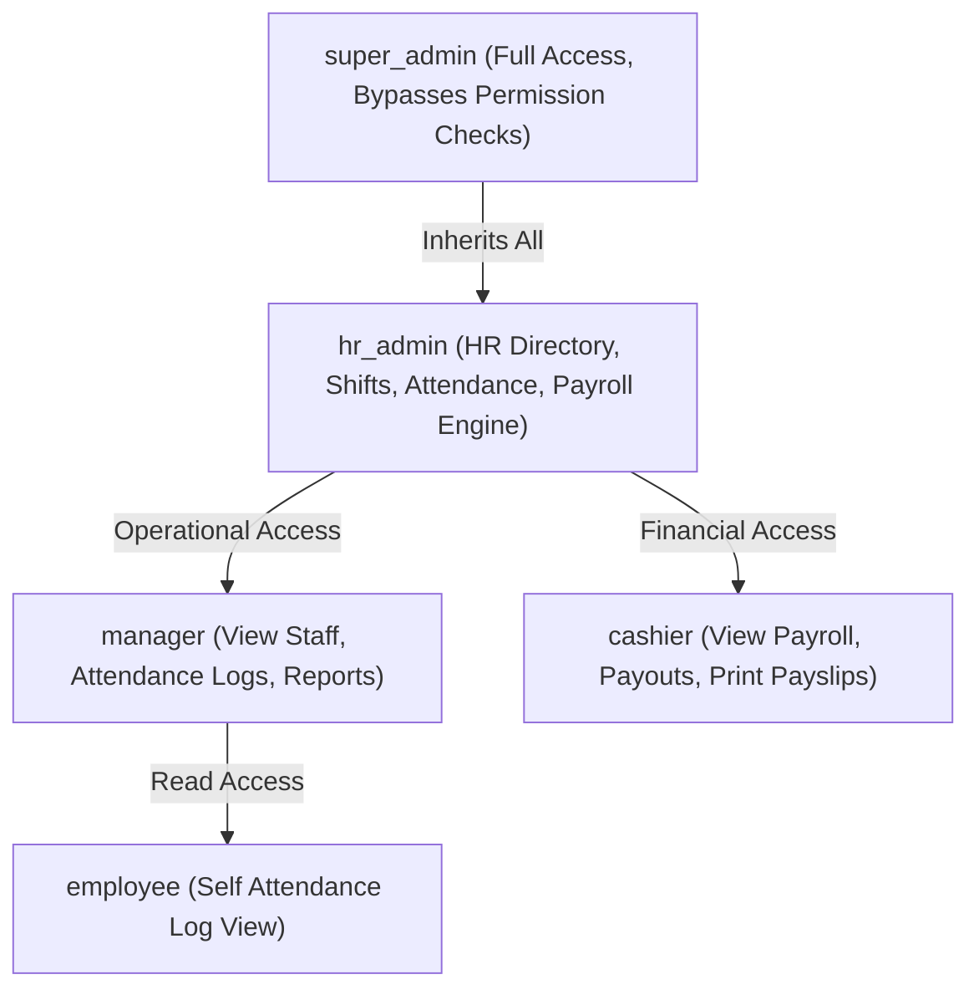
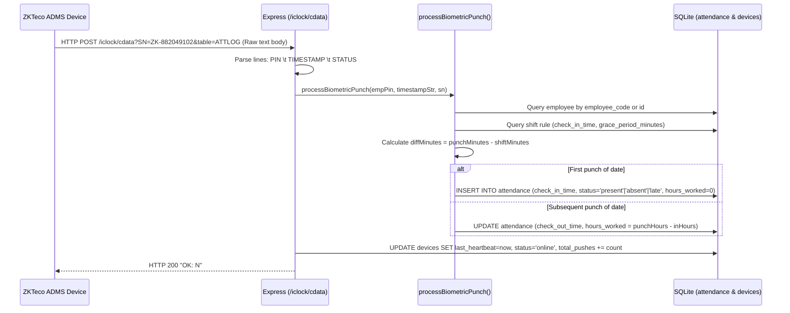
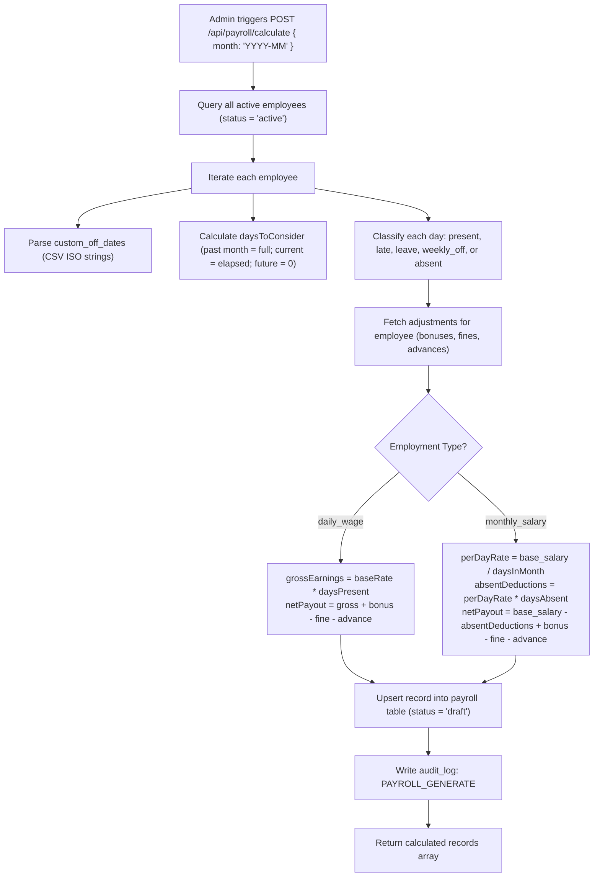

# QA_MAP.md — Application Architecture & Quality Assurance Route Map

## 1. System Architecture Discovery (Phase 0)

- **Framework & Core Runtime:**
  - **Client:** React 19.0.1 Single Page Application (SPA), React DOM 19.0.1.
  - **Build Tool:** Vite 6.2.3 with `@tailwindcss/vite` 4.1.14.
  - **Backend Server:** Express 4.21.2 REST Monolith (`server.ts`, 1,706 lines) executed via Node.js v24.12.0 using `tsx` (dev) and `esbuild` 0.25.0 bundling to `dist/server.js` (production).
  - **Language:** TypeScript 5.8.2 (`tsconfig.json`, target: ES2022, bundler module resolution, strict type checking).
  - **Package Manager:** npm (lockfile v3 present in project root and subdirectory).
- **Architecture Clarification:**
  - The application is a client-side SPA served by an Express backend. There is **no Next.js** in the repository (no App Router, no Pages Router, no Server Actions, no SSR).
- **Routing Architecture:**
  - Single-page state routing. Active tab is preserved in browser `localStorage` under key `mohsin_payroll_active_tab` across browser reloads.
  - Valid tabs: `dashboard`, `employees`, `attendance`, `payroll`, `reports`, `settings`.
  - Global navigation guard: Unauthenticated users are redirected to `<LoginPage />` via React context state (`user === null`).
- **Database & Persistence:**
  - **Engine:** `sql.js` 1.14.1 (WebAssembly SQLite).
  - **Persistence Mechanism:** Synchronous `fs.writeFileSync` to `./data/payroll.sqlite` on every write operation via `saveDatabase()`.
  - **Schema:** 10 tables (`shifts`, `employees`, `attendance`, `payroll`, `payroll_adjustments`, `devices`, `audit_logs`, `users`, `employee_documents`, `company_settings`, `departments`, `designations`).
  - **Migrations:** Lightweight inline `PRAGMA table_info` schema checks in `src/db/database.ts`.
- **Authentication & Authorization (RBAC):**
  - Stateless JSON Web Tokens (`jsonwebtoken` 9.0.3, HS256, 8-hour expiry).
  - Password hashing with `bcryptjs` 3.0.3 using 12 salt rounds.
  - Token transmission: HTTP `Authorization: Bearer <token>` or fallback query parameter `?token=<token>`.
  - Granular RBAC permissions stored as JSON in the `users.permissions` column. Super admin bypasses all permission checks.
- **Biometric Hardware Integration:**
  - ZKTeco ADMS device push protocol handler on `/iclock/cdata`, `/iclock/getrequest`, `/iclock/devicecmd`.
  - Real-time punch ingestion parsing raw tab-delimited ATTLOG lines (`PIN \t TIMESTAMP \t STATUS ...`).
- **File Uploads & Documents:**
  - `multer` 2.2.0 disk storage targeting `./data/documents/<employee_id>` and `./data/profile_pictures`.
- **Security Middleware:**
  - `helmet` 8.3.0 (Content Security Policy, frame options).
  - `cors` 2.8.6 (configured via `CORS_ORIGIN` environment variable).
  - `express-rate-limit` 8.6.2 (global 2000 req/15m, strict auth rate limit 5 req/15m).
  - `zod` 4.4.3 runtime validation on incoming request bodies and query parameters.

---

## 2. Comprehensive Route & Endpoint Map (Phase 1)

### 2.1 Frontend Tabs & Views

| Tab Identifier | Purpose | Authentication | Authorization Requirement | Important UI Elements | API Dependencies | Data Dependencies | Risk Level |
| :--- | :--- | :--- | :--- | :--- | :--- | :--- | :--- |
| **`dashboard`** | Executive KPI summary | Required | Any authenticated user | 6 solid metric cards, recent attendance activity table, online terminal indicator | `GET /api/dashboard/metrics` `GET /api/attendance?date=` `GET /api/devices` | `employees`, `attendance`, `devices` | **Medium** |
| **`employees`** | Personnel management & onboarding | Required | `employees.view` to list; `employees.add` / `employees.edit` / `employees.delete` | Search bar, department/type filters, Onboard Employee modal, off-days popup, profile detail drawer, document manager | `GET /api/employees` `POST /api/employees` `PUT /api/employees/:id` `DELETE /api/employees/:id` `POST /api/employees/:id/documents` `GET /api/departments` `GET /api/designations` | `employees`, `shifts`, `employee_documents` | **High** |
| **`attendance`** | Biometric logs, shifts & manual overrides | Required | `attendance.view` to view; `attendance.override` for overrides; `attendance.manage_shifts` for shifts | Date picker, Daily Roster vs Complete History switcher, Override modal, Multi-date Range Entry modal, Shift editor, Biometric simulator | `GET /api/attendance` `POST /api/attendance/override` `POST /api/attendance/bulk-override` `POST /api/attendance/punch-simulate` `GET/POST/PUT /api/shifts` | `attendance`, `employees`, `shifts` | **Critical** |
| **`payroll`** | Compensation engine, adjustments & payslips | Required | `payroll.view` to view; `payroll.calculate` to calculate; `payroll.adjustments` for adjustments | Month selector, Calculate button, Payroll summary table, Add Adjustment modal, Printable payslip modal | `POST /api/payroll/calculate` `GET /api/payroll/records` `POST /api/payroll/adjustments` `GET /api/payroll/adjustments` | `payroll`, `payroll_adjustments`, `employees` | **Critical** |
| **`reports`** | Executive reports & Excel/PDF exports | Required | `payroll.view` / `employees.view` | Daily vs Monthly switcher, From/To range picker, Export to Excel button, Print PDF summary button | `GET /api/payroll/range?from=&to=` `GET /api/settings/company` | `payroll`, `attendance`, `employees`, `company_settings` | **High** |
| **`settings`** | Company setup & RBAC user management | Required | `settings.view` to view; `settings.company_setup` for company; `settings.user_roles` for users | Subtabs (Company Profile vs User Roles), company setup form, logo uploader, users table, user edit modal with permission checkboxes | `GET/PUT /api/settings/company` `POST /api/settings/company/logo` `GET/POST/PUT/DELETE /api/settings/users` `GET /api/audit-logs` | `company_settings`, `users`, `audit_logs` | **Critical** |

---

### 2.2 Backend REST API Endpoints

| HTTP Method | Path | Auth Required | Required Permission | Input Contract / Zod Schema | Important Operations & Outputs | Risk Level |
| :--- | :--- | :--- | :--- | :--- | :--- | :--- |
| `POST` | `/api/auth/login` | No (Rate limit: 5/15m) | Public | `loginSchema`: `{ email, password }` | Authenticates against `users` table via bcrypt; returns JWT token + user object | **Critical** |
| `GET` | `/api/auth/me` | Yes (`Bearer`) | Authenticated | None | Returns decoded JWT session claims | **Low** |
| `POST` | `/api/auth/change-password` | Yes (`Bearer`) | Authenticated | `{ currentPassword, newPassword }` | Verifies current hash, writes new bcrypt hash (12 rounds) | **Medium** |
| `GET` | `/api/departments` | Yes (`Bearer`) | `employees.view` | None | Returns sorted list of department names | **Low** |
| `POST` | `/api/departments` | Yes (`Bearer`) | `employees.add` | `{ name: string.min(1) }` | Inserts unique department name | **Low** |
| `GET` | `/api/designations` | Yes (`Bearer`) | `employees.view` | None | Returns sorted list of designations | **Low** |
| `POST` | `/api/designations` | Yes (`Bearer`) | `employees.add` | `{ name: string.min(1) }` | Inserts unique designation name | **Low** |
| `GET` | `/api/employees` | Yes (`Bearer`) | `employees.view` | None | Returns all active and inactive employees | **High** |
| `GET` | `/api/employees/next-code` | Yes (`Bearer`) | `employees.add` | None | Calculates `Math.max(EMP-X) + 1` | **Low** |
| `GET` | `/api/employees/:id` | Yes (`Bearer`) | `employees.view` | URL param `id` | Returns single employee record | **Medium** |
| `POST` | `/api/employees` | Yes (`Bearer`) | `employees.add` | `createEmployeeSchema` | Creates employee row, enforces unique `employee_code` | **High** |
| `PUT` | `/api/employees/:id` | Yes (`Bearer`) | `employees.edit` | `updateEmployeeSchema` | Updates employee details, compensation, and off-dates | **High** |
| `DELETE`| `/api/employees/:id` | Yes (`Bearer`) | `employees.delete` | URL param `id` | Deletes employee row (leaves orphaned attendance & files) | **High** |
| `GET` | `/api/employees/:id/documents` | Yes (`Bearer`) | `employees.view` | URL param `id` | Lists attached document metadata | **Medium** |
| `POST` | `/api/employees/:id/documents` | Yes (`Bearer`) | `employees.add` | Multipart `files` (max 10) | Uploads PDF/JPEG/PNG/DOCX to `data/documents/<id>/` | **High** |
| `GET` | `/api/employees/:id/documents/:docId/download` | Yes (`Bearer`) | `employees.view` | URL params | Sends file stream via `res.download` | **High** |
| `DELETE`| `/api/employees/:id/documents/:docId` | Yes (`Bearer`) | `employees.delete` | URL params | Deletes row and unlinks file from disk | **Medium** |
| `POST` | `/api/employees/:id/profile-picture` | Yes (`Bearer`) | `employees.edit` | Multipart single `picture` | Saves image to `data/profile_pictures` and updates `photo_url` | **Medium** |
| `GET` | `/api/employees/:id/profile-picture/:filename` | **No (Public)** | Public | URL param `filename` | Serves employee avatar image file directly | **Medium** |
| `DELETE`| `/api/employees/:id/profile-picture` | Yes (`Bearer`) | `employees.edit` | URL param `id` | Removes image file from disk and clears `photo_url` | **Low** |
| `GET` | `/api/shifts` | Yes (`Bearer`) | `attendance.view` | None | Lists all configured shift policies | **Low** |
| `POST` | `/api/shifts` | Yes (`Bearer`) | `attendance.manage_shifts` | `createShiftSchema` | Creates shift with check-in, check-out, grace period | **Medium** |
| `PUT` | `/api/shifts/:id` | Yes (`Bearer`) | `attendance.manage_shifts` | `updateShiftSchema` | Updates shift times and grace settings | **Medium** |
| `GET` | `/api/attendance` | Yes (`Bearer`) | `attendance.view` | Query: `date`, `month`, `all`, `employee_id` | Returns attendance logs joined with employee records | **High** |
| `POST` | `/api/attendance/override` | Yes (`Bearer`) | `attendance.override` | `attendanceOverrideSchema` | Inserts/updates manual attendance record and triggers payroll sync | **Critical** |
| `POST` | `/api/attendance/bulk-override` | Yes (`Bearer`) | `attendance.override` | `bulkAttendanceSchema` (up to 366 items) | Batch inserts/updates attendance and triggers payroll sync | **Critical** |
| `POST` | `/api/attendance/punch-simulate` | Yes (`Bearer`) | `attendance.add` | `{ employee_id, punch_type, custom_time }` | Simulates live biometric push | **Medium** |
| `POST` | `/api/payroll/calculate` | Yes (`Bearer`) | `payroll.calculate` | `{ month: "YYYY-MM" }` | Runs full monthly payroll calculation engine and updates `payroll` table | **Critical** |
| `GET` | `/api/payroll/records` | Yes (`Bearer`) | `payroll.view` | Query: `month` | Returns precomputed monthly payroll records; auto-calculates if missing/draft | **High** |
| `GET` | `/api/payroll/range` | Yes (`Bearer`) | `payroll.view` | Query: `from`, `to` (YYYY-MM-DD) | Computes read-only prorated payroll summary over arbitrary date span | **Critical** |
| `POST` | `/api/payroll/adjustments` | Yes (`Bearer`) | `payroll.adjustments` | `payrollAdjustmentSchema` | Adds bonus, fine, or advance deduction | **Critical** |
| `GET` | `/api/payroll/adjustments` | Yes (`Bearer`) | `payroll.view` | Query: `employee_id`, `month` | Fetches adjustment line items for payslip breakdown | **High** |
| `GET` | `/api/devices` | Yes (`Bearer`) | `attendance.view` | None | Lists biometric devices with heartbeat and push counts | **Medium** |
| `POST` | `/api/devices` | Yes (`Bearer`) | `attendance.manage_shifts` | `{ serial_number, name, location }` | Registers biometric terminal | **Medium** |
| `GET` | `/api/dashboard/metrics` | **No (Public)** | **None (Missing Auth)** | None | **Exposes headcount, accruals, monthly payroll estimates** | **Critical** |
| `GET` | `/api/audit-logs` | Yes (`Bearer`) | `settings.view` | None | Lists last 100 system audit trail entries | **Medium** |
| `GET` | `/api/settings/company` | Yes (`Bearer`) | `settings.view` | None | Returns organization name, address, contact, logo URL | **Low** |
| `PUT` | `/api/settings/company` | Yes (`Bearer`) | `settings.company_setup` | `companySettingsSchema` | Updates organization profile | **Medium** |
| `POST` | `/api/settings/company/logo` | Yes (`Bearer`) | `settings.company_setup` | Multipart single `logo` | Saves logo to `data/company/` with timestamp query cache-buster | **Medium** |
| `GET` | `/api/settings/company/logo/:filename` | **No (Public)** | Public | URL param `filename` | Serves company logo image file | **Low** |
| `GET` | `/api/settings/users` | Yes (`Bearer`) | `settings.user_roles` | None | Lists system user accounts with parsed JSON permissions | **Critical** |
| `POST` | `/api/settings/users` | Yes (`Bearer`) | `settings.user_roles` | `createUserSchema` | Creates system user with bcrypt password hash | **Critical** |
| `PUT` | `/api/settings/users/:id` | Yes (`Bearer`) | `settings.user_roles` | `updateUserSchema` | Updates user details, role, password, and permissions | **Critical** |
| `DELETE`| `/api/settings/users/:id` | Yes (`Bearer`) | `settings.user_roles` | URL param `id` | Deletes user account (flawed self-deletion check) | **Critical** |
| `GET` | `/iclock/cdata` | No | ZKTeco ADMS Protocol | Query `SN` | Biometric terminal handshake & config delivery | **High** |
| `POST` | `/iclock/cdata` | No | ZKTeco ADMS Protocol | Query `SN`, `table=ATTLOG`, raw text body | Ingests tab-delimited punch lines, updates heartbeat & status | **Critical** |
| `GET` | `/iclock/getrequest` | No | ZKTeco ADMS Protocol | Query `SN` | Device command polling | **Low** |
| `POST` | `/iclock/devicecmd` | No | ZKTeco ADMS Protocol | Raw body | Command execution acknowledgement | **Low** |

---

## 3. User Roles & RBAC Matrix

The system implements 5 user roles: `super_admin`, `hr_admin`, `manager`, `cashier`, and `employee`.

### Detailed Permissions Breakdown

| Role | Module Access | Permitted Actions | Forbidden Actions | Data Scope |
| :--- | :--- | :--- | :--- | :--- |
| **`super_admin`** | Dashboard, Employees, Attendance, Payroll, Reports, Settings | Unrestricted across all endpoints and actions. Bypasses `requirePermission`. | None (intended to be prevented from self-deletion, though flawed in implementation). | Full global database visibility, all salaries, credentials, and audit logs. |
| **`hr_admin`** | Dashboard, Employees, Attendance, Payroll, Reports | Add/edit employees, document upload, attendance overrides, bulk entries, shift updates, run payroll calculations, add adjustments, print slips/reports. | Creating/modifying other administrative users (unless explicitly granted `settings.user_roles` permission). | Complete employee PII, attendance records, payroll earnings, and adjustments. |
| **`manager`** | Dashboard, Employees, Attendance, Reports | View employee list, view attendance roster and complete history, view reports. | Onboarding employees, editing salary/bank details, deleting records, running payroll, adding bonuses/fines, modifying shifts. | Employee directory, attendance logs, department reports. PII is visible, but write actions are disabled. |
| **`cashier`** | Dashboard, Payroll, Reports | View payroll records, print payslips, export payment summaries, view bank accounts. | Employee onboarding, editing shift rules, modifying system settings, user management, manual attendance overrides. | Net payout figures, bank account numbers, gross earnings, deduction breakdowns. |
| **`employee`** | Self-service view (intended) | View own attendance logs via scoped queries (`/api/attendance?employee_id=...`). | All write actions, payroll calculation, settings, view other employees' records. | Self records only. |

---

## 4. Critical Business Workflows

### Workflow 1: Biometric Hardware Punch Ingestion

### Workflow 2: Dual-Model Payroll Calculation

### Workflow 3: Employee Onboarding & Verification
1. Admin opens Employees tab -> clicks "Onboard Employee".
2. Client queries `GET /api/employees/next-code` -> pre-fills auto-incremented code (e.g. `EMP-1004`).
3. Admin inputs personal details, CNIC, joining date, compensation model (`monthly_salary` or `daily_wage`), base salary, shift assignment, and selects custom off-dates.
4. Client posts `POST /api/employees` -> server validates with `createEmployeeSchema` -> inserts into `employees` table.
5. If profile picture selected: Client posts `POST /api/employees/:id/profile-picture` (multipart).
6. If verification documents attached: Client posts `POST /api/employees/:id/documents` (multipart) -> stored under `data/documents/<id>/`.

### Workflow 4: Arbitrary Date Range Reporting & Export
1. User navigates to Reports tab.
2. Selects "Daily" (collapses to single date) or "Monthly" (selects arbitrary From -> To window, e.g. `2026-07-26` to `2026-08-25`).
3. Client issues `GET /api/payroll/range?from=...&to=...`.
4. Server computes read-only prorated gross earnings and elapsed absence deductions across each day in the window without writing to the `payroll` table.
5. User clicks "Export to Excel" (`xlsx-js-style` builds multi-column workbook) or "Print PDF Summary" (`printFormattedDocument` opens popup window with styled HTML).

---

## 5. Security & Risk Surface Analysis

1. **Unauthenticated Financial Leakage (High Risk):** `/api/dashboard/metrics` permits any anonymous client on the network to view company payroll baselines, daily costs, and headcounts.
2. **Adjustment Target-Month Misattribution (Critical Risk):** The payroll engine filters adjustments by `created_at` timestamp rather than target month, silently dropping adjustments created after month-end and crediting them to the subsequent month.
3. **Overnight Shift Arithmetic Inversion (High Risk):** Calculating work duration without modulo 24-hour rollover destroys all night shift attendance hours (`hours_worked = 0.0`).
4. **Self-Deletion Privilege Bypass (Medium Risk):** The logic intended to prevent an administrator from deleting their own profile fails due to comparing `targetUser.name` with `user.email`.
5. **Stored XSS in Document Printing (Medium Risk):** Raw string interpolation into `contentHtml` rendered via `document.write` enables script execution inside the application window.
6. **In-Memory Concurrency Desynchronization (High Architectural Risk):** `sql.js` keeps the database in Node.js process heap memory. In multi-worker or clustered environments, writes by one process are not visible to others, and concurrent `saveDatabase()` calls will overwrite the disk file.
